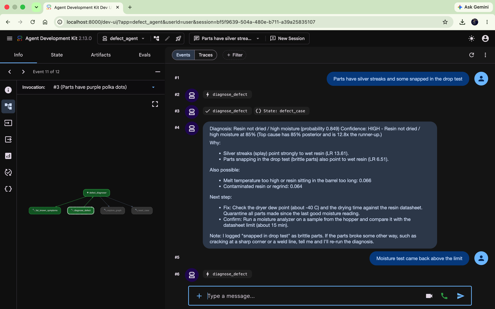
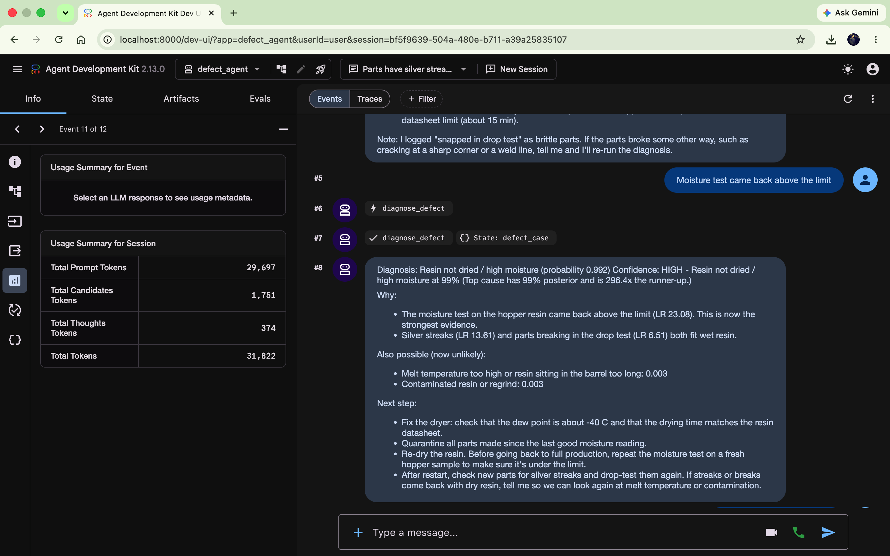

# Defect Diagnoser — Google ADK agent powered by Claude

Diagnoses an injection-molding defect from a small knowledge graph and states how confident it is.
The LLM (Claude via the Anthropic API by default; Gemini on Vertex AI also works) translates the
operator's words and explains the answer; **every
probability and confidence label is computed by a deterministic Bayesian engine over the graph**, so the
model cannot talk itself into false certainty.

```
"Silver streaks near the gate, a few parts snapped in the drop test."
→ Resin not dried / high moisture (85%)
  Confidence: HIGH - Top cause has 85% posterior and is 12.8x the runner-up.
  Why: splay observed (LR 13.6), brittle parts (LR 6.5)
  Next step: Moisture analysis of hopper resin (0.37 bits expected info gain, 15 min)
```

## Screenshots

The operator describes the defect in plain words. Claude maps them to graph symptoms, calls
`diagnose_defect`, and explains the engine's result. The agent graph on the left shows which tools ran.



Evidence accumulates in session state. When the moisture test comes back above the limit, the same case
updates to 99% and the runner-up falls to 0.3%. The left panel shows token usage for the session.



## Layout

| File | What it does |
|---|---|
| `defect_agent/kg_data.json` | The knowledge graph: 10 root causes, 12 symptoms, 10 checks, process parameters, priors and edge weights |
| `defect_agent/kg.py` | Builds the graph (networkx) and does inference, explanation, stability testing and next-best-check ranking |
| `defect_agent/agent.py` | ADK `root_agent` with 4 tools: `diagnose_defect`, `list_known_symptoms`, `explore_graph`, `reset_case` |
| `deploy.py` | Deploy to / query / delete on Vertex AI Agent Engine |
| `.env.example` | Template for `.env` (model, Anthropic API key, Google Cloud settings) |
| `tests/` | 17 offline tests, including the full ADK runner loop with a scripted model |

## The graph

```
RootCause --CAUSES(p)---------> Symptom      p = P(symptom seen | cause)
RootCause --VERIFIED_BY(sens)--> Check        sensitivity + false-positive rate
RootCause --CONTROLLED_BY------> Parameter    what to adjust
```

## How confidence is produced

1. **Posterior** — single-fault Bayes with a noisy-OR leak (2%): symptoms present, symptoms explicitly
   absent, and check results (via sensitivity/false-positive rate) all update the belief. Unmentioned
   symptoms are treated as unknown, not absent.
2. **"None of the above" hypothesis** — an `unmodeled_cause` node keeps 5% prior mass. Incoherent symptom
   combinations shift mass to it and raise `out_of_graph_warning` instead of forcing a match.
3. **Label** — `high` needs ≥75% posterior *and* ≥3× the runner-up; `medium` ≥50%; else `low`;
   `none` with no evidence. Thresholds live at the top of `kg.py`.
4. **Stability check** — every edge weight is jittered 300 times in logit space; if the top cause stays on
   top in <80% of runs, a `high` is downgraded to `medium`. This catches answers that hinge on someone's
   guessed number.
5. **Next best action** — ranks unasked symptoms and un-run checks by expected information gain, so a
   `low` answer comes with the single most useful thing to do next.

Each candidate carries per-evidence likelihood ratios, so the "why" is traceable to graph edges.

## Run locally

```bash
pip install -r requirements.txt
python -m pytest -q tests                # no API key or cloud needed

cp .env.example .env                     # then set ANTHROPIC_API_KEY
adk web                                  # chat UI at localhost:8000, pick defect_agent
```

Get an API key at [platform.claude.com](https://platform.claude.com). `.env` is git-ignored, so the key
stays out of the repo.

### Choosing the model

`DEFECT_AGENT_MODEL` picks the LLM; it defaults to `claude-opus-5-5`.

- **`claude-*` names** call the Anthropic API directly through ADK's `AnthropicLlm` and need
  `ANTHROPIC_API_KEY`. ADK would otherwise route a bare `claude-*` string to Claude on Vertex AI.
- **Gemini names** (e.g. `gemini-3.5-flash`) go to Vertex AI. Set `GOOGLE_CLOUD_PROJECT`, enable the
  API with `gcloud services enable aiplatform.googleapis.com`, and run
  `gcloud auth application-default login`. If your region doesn't serve the model, set
  `GOOGLE_CLOUD_LOCATION=global`.

## Deploy to Vertex AI Agent Engine

```bash
gcloud services enable aiplatform.googleapis.com
gsutil mb -l us-central1 gs://YOUR-staging-bucket     # if you don't have one
python deploy.py deploy
python deploy.py query --resource projects/.../reasoningEngines/...
```

`deploy.py` wraps the agent in `AdkApp` (tracing on) and ships `defect_agent/` including the JSON graph.
Sessions are managed by Agent Engine, so the multi-turn evidence in session state persists between calls.

`deploy.py` passes only `DEFECT_AGENT_MODEL` to the deployed agent. To deploy with a Claude model, the
agent also needs `ANTHROPIC_API_KEY`; add it to `env_vars` in `deploy.py`, ideally from Secret Manager.

## Adapting it to your line

- Replace priors with your share of closed defect tickets per root cause, and edge weights with
  P(symptom | cause) from those tickets. Priors (including `unmodeled_cause`) must sum to 1; the loader checks.
- **Calibrating:** run `KG.diagnose` over historical tickets and bin by stated probability; if 80%
  predictions are right ~80% of the time you're calibrated. If not, adjust the leak / unmodeled prior or
  the thresholds.
- For a larger graph, the same `kg.py` interface can sit on Spanner Graph or Neo4j — only `_build_graph`
  and the data loading change.

## Limits

Single-fault assumption: two simultaneous root causes will tend to show up as low confidence or an
out-of-graph warning rather than two answers. Edge weights in the shipped JSON are illustrative, not
plant data.
